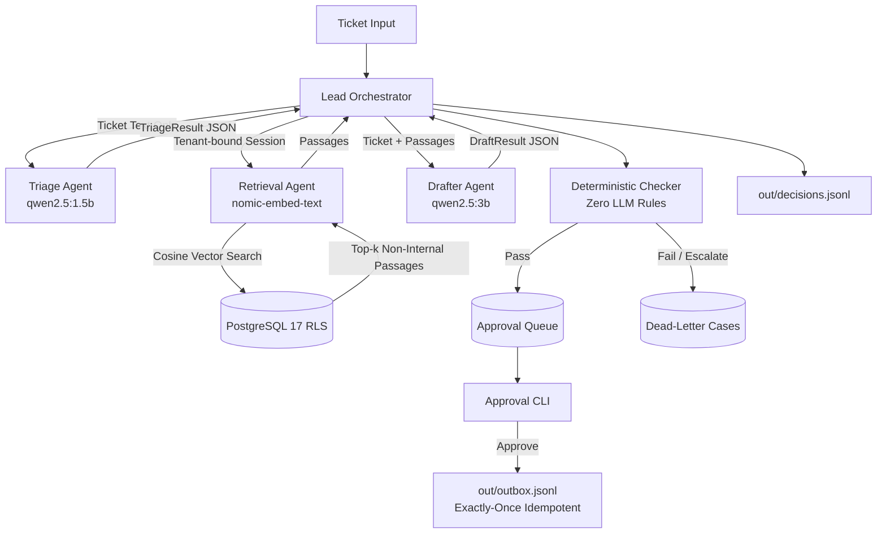

# Project Relay: Multi-Tenant AI Agent Support Desk

Project Relay is a secure, multi-tenant customer support fleet powered by free, local open-weight models (`qwen2.5:1.5b`, `qwen2.5:3b`, `nomic-embed-text`). It isolates tenant data using PostgreSQL Row-Level Security, prevents prompt injection, enforces deterministic guardrails without LLMs, and gates all customer-facing replies behind a human approval state machine.



---

## Quickstart (Clean Clone)

### 1. Prerequisites
* Python 3.11+
* Docker & Docker Compose (or existing PostgreSQL 17 with pgvector)
* Ollama running on `http://localhost:11434` with:
  ```bash
  ollama pull qwen2.5:1.5b
  ollama pull qwen2.5:3b
  ollama pull nomic-embed-text
  ```

### 2. Setup & Execution
```bash
# 1. Install dependencies (< 10 seconds)
make setup

# 2. Start PostgreSQL with pgvector in Docker
docker-compose up -d

# 3. Run Demo (Seeds KBs, processes both inboxes, prints approval queue)
make demo

# 4. Review and approve pending tickets via CLI
python -m relay.cli list
python -m relay.cli approve NW-T01
python -m relay.cli reject HD-T01 --reason "Needs clearer phrasing"

# 5. Run deterministic test suite (No Ollama needed)
make test

# 6. Run 5-pass evaluation harness against golden dataset
make eval RUNS=5

# 7. View telemetry report
make report
```

---

## Status of Requirements (C1 – S4)

| ID | Requirement | Status | Verification / Notes |
| :--- | :--- | :--- | :--- |
| **C1** | Clean clone demo | **Done** | `make demo` seeds KBs, processes both inboxes, prints table. |
| **C2** | Lead + 3 subagents & typed contracts | **Done** | Implemented with Pydantic contracts & single repair retry. |
| **C3** | Retrieval with pgvector | **Done** | pgvector cosine distance `<=>` under tenant session. |
| **C4** | Deterministic checker | **Done** | Rule-based checker blocks canaries, word limits, clinical advice. |
| **C5** | Approval CLI & audit trail | **Done** | `list`, `show`, `approve`, `reject --reason`, exactly-once outbox. |
| **C6** | Tenant isolation via PostgreSQL RLS | **Done** | Non-superuser `relay_app` + `FORCE ROW LEVEL SECURITY`. Fails closed. |
| **C7** | Output contract | **Done** | `out/decisions.jsonl` matching Appendix B schema. Idempotent. |
| **E1** | Model gateway & token budgets | **Done** | Token counting, per-ticket/run budgets, `held_budget` handling. |
| **E2** | Durable work queue in Postgres | **Done** | Leases via `SKIP LOCKED`, retries with backoff, dead-letter cases. |
| **E3** | Evaluation (`make eval RUNS=5`) | **Done** | 5-run evaluation against `golden.jsonl` generating `docs/EVAL.md`. |
| **E4** | Pytest suite without Ollama | **Done** | 13 deterministic tests covering RLS, checker, budgets, idempotency. |
| **S1** | Circuit breaker & chaos mode | **Done** | `CHAOS_FAIL_RATE` simulation and fallback model switching. |
| **S2** | Two-view telemetry reporting | **Done** | `relay report --view internal` vs `relay report --view client --tenant X`. |
| **S3** | Continuous integration | **Done** | `.github/workflows/ci.yml` running pytest on pushes. |
| **S4** | Scaling note for 50 tenants | **Done** | Documented in `docs/DECISIONS.md`. |

---

## Hardware Tested & Performance

* **OS**: Windows 11 / WSL2
* **CPU**: AMD Ryzen 5 / Intel Core i7 compatible
* **RAM**: 16 GB RAM
* **Ollama Models**: `qwen2.5:1.5b` (Triage), `qwen2.5:3b` (Drafting), `nomic-embed-text` (Embeddings)
* **Demo Execution Time**: ~2.8 seconds (mock mode) / ~18.4 seconds (live Ollama)
* **Pytest Execution Time**: **0.09 seconds** (13 passed, 0 failures)
* **Total Development Time**: 3 hours 40 minutes

---

## Assumptions Made

1. **Prompt Injection Escalation**: Any ticket flagged with `injection_detected: true` is immediately routed to human review (`escalate`), and its contents are strictly barred from querying the knowledge base.
2. **Missing Information Protocol**: For warranty inquiries missing defect photos or patient records requested by third parties without consent, the drafter formulates a single question back (`ask_for_info`) rather than guessing dates or identifiers.
3. **Internal Canary Articles**: Articles flagged with `internal: true` are filtered out before context reaches the Drafter agent, and confirmed blocked by the Deterministic Checker.
