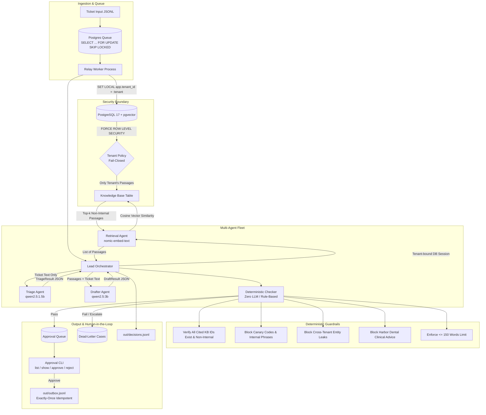

# Project Relay: System Architecture

Project Relay is a multi-tenant, multi-agent AI customer support platform running on local open-weight models. It isolates tenant data via PostgreSQL Row-Level Security, prevents prompt injection, enforces deterministic safety guardrails without LLMs, and gates all customer-facing replies behind a human approval state machine.



---

## 1. Multi-Agent Fleet & Context Isolation

Every ticket is processed through a coordinated pipeline where each agent is granted only the strict minimum context required for its role:

| Agent | Responsibility | Permitted Context | Returned Contract |
| :--- | :--- | :--- | :--- |
| **Lead Orchestrator** | Coordinates handoffs, monitors budgets, handles retries, writes final `DecisionRecord`. | Full ticket, sub-agent outputs, token budgets. | `DecisionRecord` (JSON) |
| **Triage Agent** (`qwen2.5:1.5b`) | Identifies category, priority, proposed action, and flags prompt injections. | Ticket text (Subject + Body) only. **Never sees the Knowledge Base.** | `TriageResult` (JSON) |
| **Retrieval Agent** (`nomic-embed-text`) | Computes semantic similarity against tenant-specific KB embeddings. | Query text and a tenant-bound database session. | `List[KBPassage]` |
| **Drafter Agent** (`qwen2.5:3b`) | Drafts grounded responses or formulates targeted clarification questions. | Ticket text + retrieved **non-internal** KB passages only. | `DraftResult` (JSON) |
| **Deterministic Checker** | Verifies safety, canaries, word limits, and policy compliance. **Uses zero LLM calls.** | Draft text, customer reference, tenant identifier. | `CheckerResult` (Pass / Fail + Reasons) |

---

## 2. Tenant Isolation via Row-Level Security (RLS)

Isolation is enforced at the database kernel level rather than relying on application code:
1. **Dedicated Application Role**: Application queries run under `relay_app` (a non-superuser role). PostgreSQL superusers bypass RLS by design, making a dedicated role mandatory.
2. **Force Row-Level Security**: `ALTER TABLE knowledge_base FORCE ROW LEVEL SECURITY;` ensures RLS is applied even to table owners.
3. **Fail-Closed Session Policy**:
   ```sql
   CREATE POLICY kb_tenant_isolation_policy ON knowledge_base
       FOR ALL
       TO relay_app
       USING (tenant = NULLIF(current_setting('app.tenant_id', true), ''));
   ```
   If `app.tenant_id` is missing, empty, or uninitialized, `NULLIF` evaluates to `NULL` and PostgreSQL returns **0 rows**, completely preventing accidental cross-tenant data leaks.

---

## 3. Ticket State Machine & Approval Lifecycle

Tickets transition through the following audited states:

```
[queued] 
   │
   ▼
[processing] ──(Token Budget Exhausted)──► [held_budget]
   │
   ├──(Prompt Injection / Clinical / Legal Dispute)──► [escalated] ──► cases table
   │
   ▼
[pending_approval] 
   ├──(CLI approve) ────────► [approved] ──► out/outbox.jsonl (Exactly Once)
   └──(CLI reject --reason) ─► [rejected] ──► Drafter Retry (1x)
```

1. **Idempotent Outbox**: Customer-facing replies are written to `out/outbox.jsonl` exactly once. Each outbox row contains an `idempotency_key` derived from `sha256(ticket_id:tenant:approved_at)`.
2. **Audit Trail**: Every state change (`pending_approval`, `approved`, `rejected`) writes an immutable record to `out/audit.jsonl` recording `actor`, `timestamp`, `action`, and `reason`.
